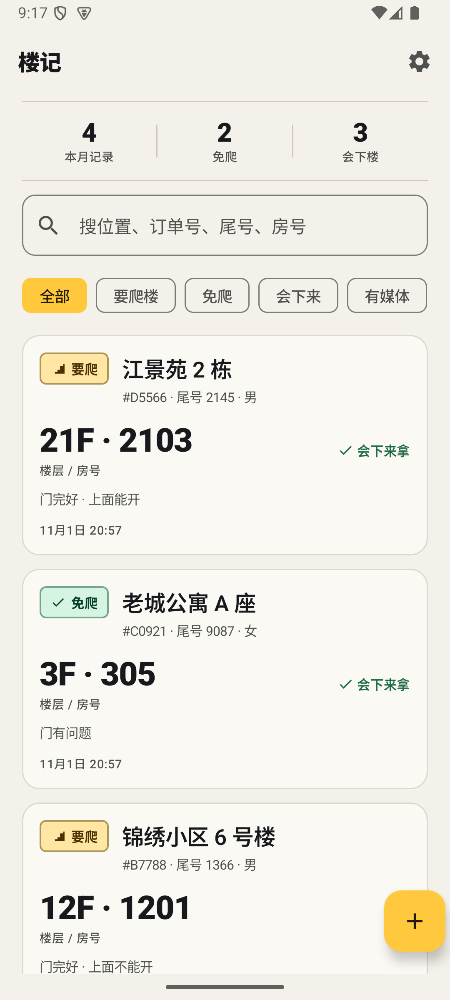
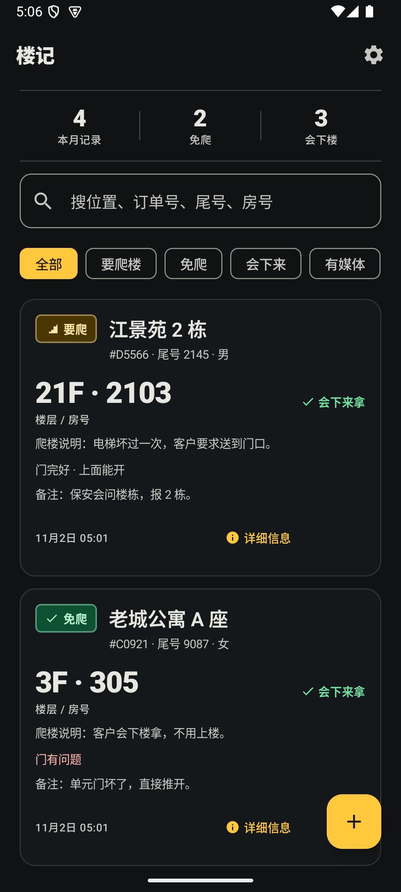
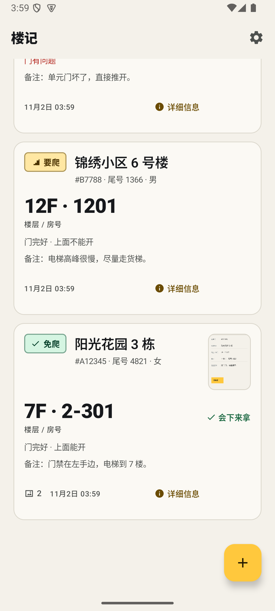
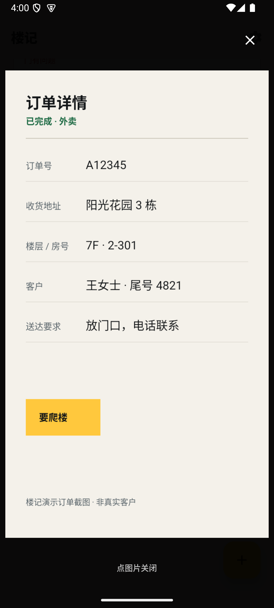
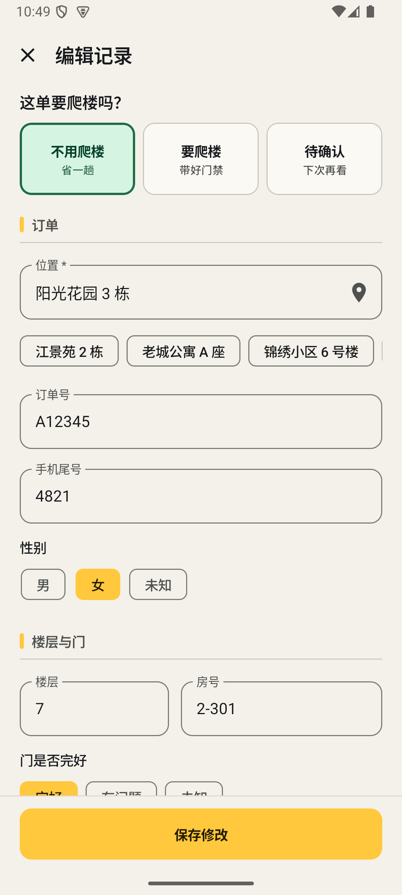
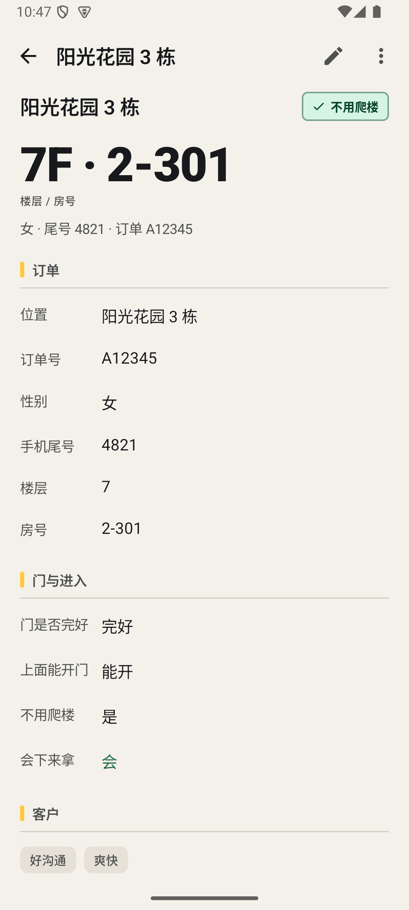
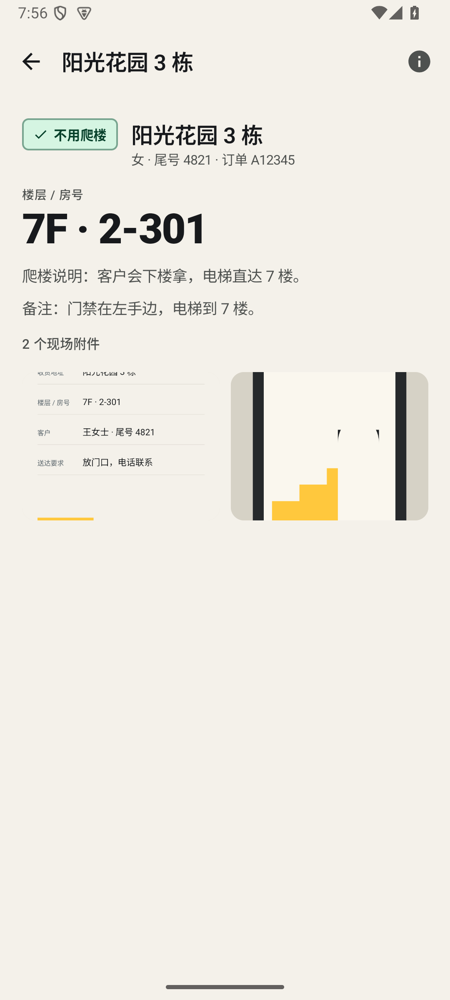
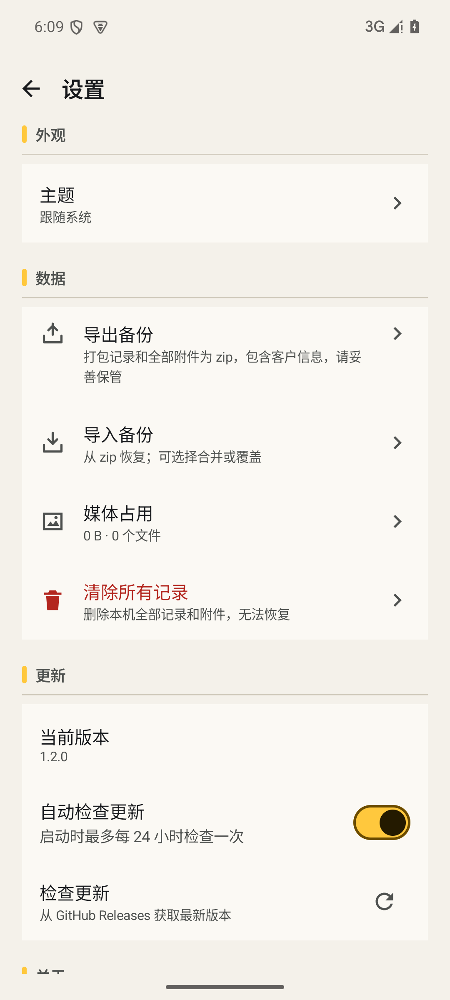

# 楼记 LouJi

给配送骑手用的私人爬楼台账。记录一单要不要爬楼、楼层房号、门和客户习惯，支持截图、拍照、录像，数据只存本机，更新从 GitHub Releases 下载。


> 截图为 v1.2.0 构建，v1.2.1 / v1.3.0 / v1.4.0 为后续修复与新增；记录均为合成演示数据，不包含真实客户信息。

## 功能

- **一眼看懂**：列表先显示「要爬 / 免爬」印章，再用大号数字显示楼层 / 房号；首页汇总本月记录、免爬、会下楼数量。
- **订单截屏缩略图**：每条有图片的记录在卡片右侧显示首张图片缩略图；点一下全屏放大订单截屏，再点图片即可关闭回到列表。
- **从剪贴板填入**：复制平台的订单文字，点「从剪贴板填入」，本地识别位置、订单号、尾号、楼层、房号和性别；已有内容会先确认再覆盖。
- **爬楼说明**：选完「要爬楼 / 不用爬楼」后，直接备注原因；字段标题会跟着选择变成「为什么要爬楼 / 为什么不用爬楼」。列表、详情、搜索、复制摘要和备份都会带上。
- **完整字段**：位置、订单号、性别、手机尾号、楼层、房号、门是否完好、上面是否能开门、是否不用爬楼、会不会下来拿、客户性格（快捷标签 + 性格备注），以及独立「备注」和「爬楼说明」。
- **现场附件**：点击条目直接进入「现场」，网格查看全部图片和视频；从系统相册导入截图 / 照片 / 视频；应用内 CameraX 拍照、录像（最长 2 分钟）；全屏查看、双指缩放、视频播放、删除附件。
- **详细信息入口**：每条记录卡片右下角都有「详细信息」，进入完整字段页；现场页顶部也有入口。
- **快速找回**：搜索位置、订单号、尾号、房号、备注、爬楼说明；筛选要爬楼 / 免爬 / 会下来；支持「活跃 / 已归档」切换与「最近更新 / 楼层 / 位置」排序；常用位置一键填入。
- **归档**：不常用的记录可归档，从主列表移出但保留在「已归档」视图，随时恢复；备份包含归档状态。
- **记录操作**：详情查看全部字段，编辑、再来一单、复制摘要、删除；删除前确认。
- **本机备份**：导出 zip（记录 + 全部附件），导入时可选合并或覆盖。
- **GitHub 更新**：检查最新 Release、下载 APK、校验 SHA-256、交给系统安装器；启动时最多每 24 小时自动检查一次。
- **深浅色 / 大字体**：Material 3 结构，浅色与深色都是一等公民；支持 1.3× 字体缩放和横屏 / 平板宽度。
- **隐私**：无账号、无统计 SDK、无广告；`allowBackup=false`，媒体存应用私有目录。可选「应用锁」，离开应用后需系统锁屏密码/指纹解锁。联网用于检查更新；点「使用当前位置」时，系统定位/地理编码服务可能用坐标解析地址。

## 截图

| 浅色列表 | 深色列表 |
| --- | --- |
|  |  |

| 订单截屏缩略图 | 点击放大 |
| --- | --- |
|  |  |

| 记录表单 | 详情 |
| --- | --- |
|  |  |

| 现场附件 | 设置 |
| --- | --- |
|  |  |

更多：深色详情、1.3× 字体、横屏、定位自动填写、[剪贴板填入](docs/screenshots/paste-order.png)、照片/视频查看器、更新弹层见 [`docs/screenshots`](docs/screenshots)。

## 安装

1. 打开 [Releases](https://github.com/Quabtun/louji/releases/latest)。
2. 下载 `louji-vX.Y.Z.apk`。
3. 在系统提示时允许浏览器/文件管理器「安装未知应用」，完成安装。

要求 Android 7.0（API 24）及以上。

应用内更新与首次安装使用同一签名密钥。设置 → 检查更新会读取 GitHub 最新 Release；下载后由系统安装器覆盖安装。

## 使用

- 点右下角 **+** 新建；先选「不用爬楼 / 要爬楼 / 待确认」，在下方写清原因，再补位置、楼层、房号、客户信息和备注。位置右侧的定位按钮可直接获取当前位置并填写；首次使用需允许定位。
- 复制订单文字后，点「订单」区块右上的「从剪贴板填入」，可一次带入位置、订单号、尾号、楼层、房号和性别。
- 点击列表条目直接进入「现场」看图片和视频；点卡片右下的「详细信息」进入完整字段。
- 在「现场」里拍照、录像或从相册选截图；附件只存本机。
- 首页搜索框支持位置、订单号、尾号、房号、备注；筛选 chips 可组合搜索。
- 详情页右上角可编辑、复制摘要、再来一单、删除。
- 设置 → 导出备份，把 zip 存到网盘或电脑；换机时用「导入备份」恢复。

## 构建

环境：

- JDK 17
- Android SDK Platform 34、Build-Tools 34.0.0
- Gradle 8.5（仓库包含 wrapper）

```bash
export JAVA_HOME=/path/to/jdk-17
export ANDROID_HOME=/path/to/Android/Sdk
./gradlew :app:assembleDebug
```

Debug APK：`app/build/outputs/apk/debug/app-debug.apk`（包名带 `.debug`）。

### Windows 中文路径说明

AGP 构建可以在中文项目路径下工作，但 Gradle 的 **JVM 单元测试 worker** 在 Windows 上可能无法从含中文的 classpath 加载测试类（`ClassNotFoundException`）。APK 构建、Lint 和仪器化测试不受影响。

如果项目位于中文路径，可在 ASCII 路径创建目录联接再跑单元测试：

```powershell
New-Item -ItemType Junction -Path D:\louji-build -Target 'D:\code\Zcode\爬楼记录工具'
```

```bash
./gradlew -p /d/louji-build :app:testDebugUnitTest
```

## 测试

```bash
# JVM 单元测试
./gradlew :app:testDebugUnitTest

# 连接 API 35 模拟器 / 真机后，运行 Room、备份、Compose 流程、相机测试
./gradlew :app:connectedDebugAndroidTest

# Android Lint
./gradlew :app:lintDebug
```

最近一次结果：31 个 JVM 单元测试通过；20 个仪器化测试通过（API 35，1080×2400；API 26 核心建记录与剪贴板流程通过）；Lint 0 error；Mimosa 静态深度扫描 0 个发现（证据边界见报告）。完整用例、证据与已知限制见 [`docs/TEST_REPORT.md`](docs/TEST_REPORT.md)，安全审计见 [`docs/AUDIT.md`](docs/AUDIT.md)，质量与演进诊断见 [`docs/QUALITY_DIAGNOSIS.md`](docs/QUALITY_DIAGNOSIS.md)。

## 发布更新

1. 修改 `app/build.gradle.kts` 的 `versionCode` / `versionName`。
2. 确保本机存在 `keystore/louji-release.jks` 和 `keystore.properties`（**不要提交**）。
3. 构建并发布：

```bash
./scripts/release.sh 1.0.1 "修复列表门锁提示"
```

脚本会构建签名 APK、生成 `.sha256`，并用 `gh release create` 发布到 GitHub。需要本机已登录 `gh`，且拥有仓库写权限。

### 签名密钥（重要）

- 首次生成：`keytool -genkeypair ... -keystore keystore/louji-release.jks`
- `keystore.properties` 保存 `storeFile` / `storePassword` / `keyAlias` / `keyPassword`。
- **务必备份这两个文件**。丢失后新 APK 无法覆盖安装在旧版本上，用户只能卸载重装（数据会丢）。
- 公开仓库不包含密钥；GitHub Actions 发版需要自行配置 Secrets，见 `.github/workflows/release.yml`。

### GitHub Actions

- `.github/workflows/ci.yml`：push / PR 时跑单元测试、Lint、Debug 构建。当前 GitHub 账号的 Actions 因计费被锁定，工作流已在仓库中暂时禁用；本地测试与发布不受影响，解除后可在 Actions 页重新启用。
- `.github/workflows/release.yml`：手动触发（workflow_dispatch），使用以下 Secrets 签名并发版：
  - `SIGNING_KEYSTORE_BASE64`（`base64 -w0 keystore/louji-release.jks`）
  - `SIGNING_STORE_PASSWORD`
  - `SIGNING_KEY_ALIAS`
  - `SIGNING_KEY_PASSWORD`

## 技术栈

- Kotlin 1.9.22 + Jetpack Compose（Material 3），单 Activity + Navigation Compose
- Room 2.6.1（记录 / 附件 1:N），DataStore Preferences
- CameraX 1.3.1（拍照 / 录像）、Media3 1.2.1（播放）、Coil 2.7.0（图片/缩略图）
- OkHttp 4.12.0 + kotlinx.serialization（GitHub Releases、备份 JSON）
- AGP 8.2.2，compileSdk/targetSdk 34，minSdk 24

目录：

```
app/src/main/java/com/quabtun/louji/
  data/            Room、Repository、媒体、备份
  model/           记录字段、校验
  ui/              list / edit / detail / media / camera / settings / update
  update/          GitHub Releases 检查、下载、安装
  util/            时间/楼层/摘要格式化、定位
design/icon/       1024 母版与渲染预览
tools/icon/        SVG → Android 密度图标（sharp）
tools/e2e/         adb + uiautomator 冒烟脚本
docs/              DESIGN.md、TEST_REPORT.md、截图
```

## 隐私

楼记不要求登录，记录、截图、照片和视频都保存在本机应用私有目录；`allowBackup=false`，不会进入系统云备份。联网只用于访问 GitHub 检查新版本；点「使用当前位置」时，系统定位或地理编码服务可能会把坐标用于解析地址。除此之外不上传任何记录。导出的 zip 包含客户信息，请自行妥善保管。

## 设计

视觉方向、颜色 / 字体 / 组件 / 图标规范和可访问性要求见 [`DESIGN.md`](DESIGN.md)。图标母版为 `design/icon/louji-master.svg`，通过 `tools/icon/render.mjs` 输出全部 Android 密度和单色主题图标。

## 已知限制

- 原生 Android 无法用 Playwright 驱动；自动化测试使用 Android 官方 instrumented test + adb/uiautomator + 模拟器截图。
- 模拟器使用软件 GPU 时，`adb screencap` 里的相机预览可能是黑的，但拍照 / 录像文件正常（相机测试已通过）。
- 首版不含云同步、账号、应用锁和 Play 商店上架。
- 未附开源许可证；代码公开可读，如需复用请先联系作者。
